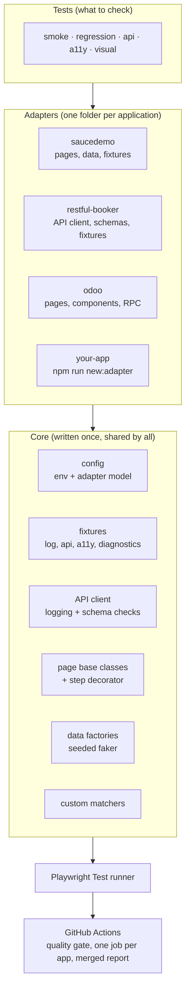

# QA Automation Framework

[](https://github.com/Abdulaziz-A-A/QA-Automation-Framework/actions/workflows/tests.yml)
[](https://github.com/Abdulaziz-A-A/QA-Automation-Framework/actions/workflows/visual.yml)

A reusable test automation framework built with **Playwright** and **TypeScript**.

The idea is simple: **one shared core, one small adapter per application.** The core holds everything
that is the same for every project (configuration, fixtures, API client, test data, accessibility,
reporting, CI). An adapter holds only what is specific to one application (its pages, its endpoints,
its tests). Testing a new application means adding a folder, not rewriting the framework.

To prove the design, the same core drives three very different applications:

| Adapter | Application | Kind | What it demonstrates |
| --- | --- | --- | --- |
| `saucedemo` | [saucedemo.com](https://www.saucedemo.com) online shop | Web UI | Page objects, login once and reuse the session, data-driven tests, accessibility, visual regression |
| `restful-booker` | [restful-booker](https://restful-booker.herokuapp.com/apidoc/index.html) booking service | REST API | Typed API client, contract (schema) checks, authorization tests, known-defect tracking |
| `odoo` | [Odoo](https://demo.odoo.com) ERP demo | Web UI + RPC | Enterprise single-page app, reusable components, seeding and cleaning data through the API |

## Architecture



## Quick start

Requirements: Node.js 20 or newer.

```bash
git clone https://github.com/Abdulaziz-A-A/QA-Automation-Framework.git
cd QA-Automation-Framework
npm ci
npx playwright install chromium
npm test            # everything except visual tests
npm run report      # open the HTML report
```

No configuration is needed for the three bundled adapters: they default to public practice sites.

## Commands

| Command | What it runs |
| --- | --- |
| `npm test` | Every test except visual |
| `npm run test:smoke` | Fast critical-path checks (`@smoke`) |
| `npm run test:regression` | Full functional coverage (`@regression`) |
| `npm run test:api` | API tests only, no browser (`@api`) |
| `npm run test:a11y` | Accessibility scans (`@a11y`) |
| `npm run test:visual` | Screenshot comparison (`@visual`) |
| `npm run test:visual:update` | Approve the current screenshots as the new baselines |
| `npm run test:saucedemo` / `test:restful-booker` / `test:odoo` | One application |
| `npm run test:core` | The framework's own self-tests |
| `npm run test:ui` | Playwright's interactive UI mode, the best way to debug |
| `npm run test:headed` | Watch the browser while tests run |
| `npm run check` | Type-check and lint |
| `npm run new:adapter -- <name> [--api]` | Scaffold an adapter for a new application |

Anything Playwright accepts also works, for example one file, one title, or another environment:

```bash
npx playwright test adapters/saucedemo/tests/regression/cart.spec.ts
npx playwright test -g "locked-out user"
TEST_ENV=staging BROWSERS=chromium,firefox npx playwright test --project="saucedemo*"
```

## What is covered

80 tests in total.

| Project | Smoke | Regression | Accessibility | Visual | Total |
| --- | ---: | ---: | ---: | ---: | ---: |
| `saucedemo` (UI) | 3 | 28 | 3 | 2 | 36 |
| `restful-booker` (API) | 2 | 19 | | | 21 |
| `odoo` (ERP UI) | 2 | 6 | 1 | | 9 |
| `core-selftest` (the framework itself) | | | | | 14 |

Highlights:

- **saucedemo**: end-to-end purchase with the order arithmetic verified (item total, 8% tax, grand total),
  six invalid-login cases from one data table, access control for signed-out users, all four sort orders,
  cart behaviour across reloads, required-field validation at checkout.
- **restful-booker**: full create, read, update, patch, delete lifecycle with every response validated
  against a strict schema; update and delete refused without a token and with a forged token, with proof
  that nothing changed; search by guest name.
- **odoo**: contact creation verified against the stored record (not only the screen), required-field
  validation, discard, search, edit. Test records are created and removed through Odoo's RPC interface.
- **core-selftest**: proves the shared pieces work and fail when they should: the matchers, factories,
  the API client against a local server, secret masking in logs, and the accessibility scan against a
  deliberately broken page.

## Project structure

```
core/                       Shared by every application. Rarely changes.
  config/env.ts             Loads .env files; validates variables with zod
  config/adapter.ts         The adapter model; turns adapters into Playwright projects
  fixtures/base.fixture.ts  The framework's `test`: log, api, a11y, failure diagnostics
  api/api-client.ts         HTTP client: a report step per call, timing, masked logs, schema checks
  pages/base-page.ts        Base classes for page objects and reusable components
  helpers/step.ts           @step() decorator: page-object methods appear as named steps in reports
  helpers/a11y.ts           axe-core scan with an impact threshold and a known-issues list
  helpers/matchers.ts       Custom assertions (toBeSorted)
  helpers/logger.ts         Per-test log attached to the report, with secrets masked
  data/factory.ts           Test-data factories on a seeded faker (failed runs can be replayed)
  tests/                    Self-tests of everything above

adapters/                   One folder per application under test.
  index.ts                  The registry of adapters
  saucedemo/                env.ts, adapter.config.ts, auth.setup.ts, fixtures.ts, pages/, data/, tests/
  restful-booker/           env.ts, adapter.config.ts, fixtures.ts, api/, data/, tests/
  odoo/                     env.ts, adapter.config.ts, auth.setup.ts, fixtures.ts, pages/, api/, data/, tests/
  _template/                The skeleton copied by `npm run new:adapter`

scripts/new-adapter.mjs     Scaffolds and registers a new adapter
scripts/summary.mjs         Writes the run summary shown on the CI job page
playwright.config.ts        One config for all applications; names no application
.github/workflows/          tests.yml (main pipeline), visual.yml (screenshot baselines)
```

## Adding a new application

```bash
npm run new:adapter -- my-app          # web application
npm run new:adapter -- billing-api --api   # API only
```

This copies the template to `adapters/my-app`, registers it in `adapters/index.ts` and adds its
variables to `.env.example`. Then:

1. Set `MY_APP_BASE_URL` (and credentials if needed) in `.env`.
2. Run it: `npx playwright test --project="my-app*"`.
3. Describe your screens as page objects in `pages/`, expose them in `fixtures.ts`, write tests in `tests/`.
4. If the application needs a login, set `auth: true` in `adapter.config.ts` and add an `auth.setup.ts`
   (copy the one from `saucedemo`). The login then runs once and every test starts signed in.

Nothing in `core/` or `playwright.config.ts` needs to change.

## Environments and secrets

Variables are layered; the first source that defines a variable wins:

```
real environment variables  >  .env.<TEST_ENV>.local  >  .env.<TEST_ENV>  >  .env
```

So `TEST_ENV=staging npm test` loads `.env.staging` on top of `.env`. Each adapter declares and validates
its own variables in its `env.ts`; a missing or malformed value stops the run immediately with a clear message.

The bundled adapters default to **public demo credentials published by the practice sites themselves**.
For a real application, give credentials no default, keep them in `.env` (git-ignored) locally, and in
GitHub Actions secrets in CI. Never point this suite at a production system.

To run the `odoo` adapter against your own Odoo instead of the public demo, set `ODOO_BASE_URL`,
`ODOO_USERNAME` and `ODOO_PASSWORD`.

## Conventions

- **Locators** follow what the user perceives: role and name first, then label or placeholder, then text,
  then a test id. No generated class names, no XPath chains.
- **No fixed waits.** Tests rely on Playwright's auto-waiting and web-first assertions; the linter rejects
  `waitForTimeout`.
- **Independent tests.** Each test starts from a known state, creates the data it needs and removes it.
  Tests run in parallel and in any order.
- **Page objects hold locators and user actions; tests hold assertions.** The one exception is
  `expectLoaded()`, a page's own "am I displayed?" check.
- **Tags** select what to run: `@smoke`, `@regression`, `@api`, `@a11y`, `@visual`.
- **Generated data is reproducible.** A failed test reports its seed; rerun with `FAKER_SEED=<seed>`.
- **Known defects stay visible.** A confirmed product defect is written as a test of the *correct*
  behaviour and marked `test.fail()` with a `defect` annotation (see
  `adapters/restful-booker/tests/regression/known-defects.spec.ts`). The suite stays green, every report
  lists the open defect, and the run turns red the day the defect is fixed, which is the reminder to
  remove the marker.
- **Known accessibility debt is listed, not ignored.** `a11y.check({ knownIssues })` reports accepted
  violations as annotations and fails only on new ones (see `adapters/odoo/tests/a11y`).

## When a test fails

The HTML report (`npm run report`) holds, for each failed test: the named steps, a screenshot, a video,
the per-test log, browser console errors and failed network requests, and a **trace**. Open the trace
from the report to step through the test with DOM snapshots and network calls at each action.

## Continuous integration

`.github/workflows/tests.yml` runs on every push and pull request:

1. **Quality gate**: type-check, lint, and the core self-tests. Nothing else runs if this fails.
2. **One job per application**, in parallel. A failure in one does not cancel the others. The `odoo` job
   targets a shared third-party demo server, so it is reported but does not fail the pipeline.
3. **Merged report**: the results of all jobs are combined into a single HTML report, kept as a
   downloadable artifact. Traces, screenshots and videos of failures are kept as a second artifact.
4. **Optional publishing**: to publish the report as a web page, set Pages source to "GitHub Actions" in
   the repository settings and create a repository variable `PUBLISH_REPORT` with the value `true`.

`.github/workflows/visual.yml` handles screenshot comparison. Baseline images are only valid in the
environment that produced them, so they are created in CI: the first run creates and commits them, later
runs compare against them, and a manual run with **update** ticked approves a new look.

## Roadmap

- AI-assisted helpers on top of the framework: test-case generation from requirements, and triage of failed runs
- Mobile layer (Appium) as another adapter kind
- Performance smoke checks (response-time budgets) in the API client

## Built with

[Playwright](https://playwright.dev) · TypeScript · [zod](https://zod.dev) · [axe-core](https://github.com/dequelabs/axe-core) · [Faker](https://fakerjs.dev) · ESLint · GitHub Actions
